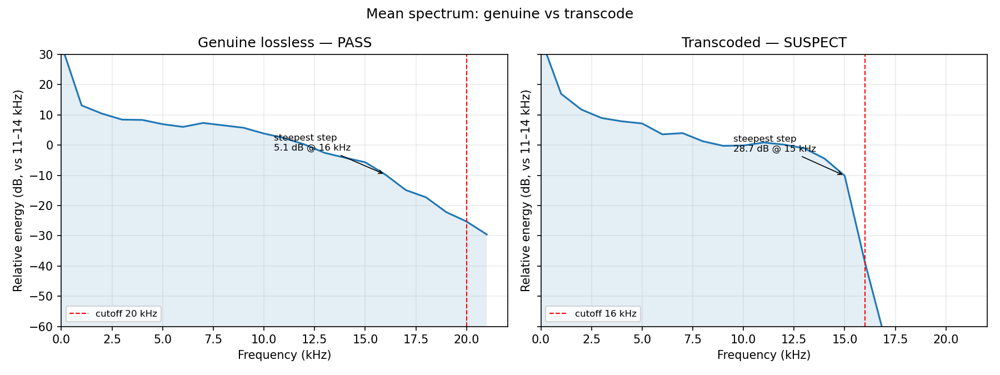

# lossless-verify — fake-lossless detector + quality sorter (FLAC, WAV, AIFF, ALAC, MP3, M4A, OGG, Opus)

The problem is real: MP3-to-FLAC transcodes are everywhere in download pools, sample packs, and "24-bit" stores. They look lossless (right extension, right bit depth) but they sound flat, especially on a big system. You cannot hear the difference on laptop speakers. You can measure it in the spectrum.

This tool automates that measurement — spectral analysis that detects lossy-to-lossless transcodes, then files everything into folders by verified quality. Built for a DJ download pipeline (fetch → analyze → sort), where you can't A/B every file on a venue system before the gig.



Left: genuine lossless: gradual rolloff, steepest 1 kHz step 5.1 dB.
Right: transcoded lossy to lossless: near-vertical brickwall, 28.7 dB drop at 15 kHz.

## How it works

For each file:

1. Decode to mono PCM via ffmpeg (native sample rate, no resampling).
2. FFT loud frames only (top 30% by energy, so silence does not bias the result).
3. Build a mean power spectrum in 1 kHz bands.
4. Find the high-frequency cutoff relative to the 11–14 kHz reference band.

Verdicts are driven by cliff steepness, not cutoff location:

| Verdict | Rule |
|---|---|
| `FAIL` | Any 1 kHz step drops > 40 dB (unambiguous brickwall) |
| `SUSPECT` | A step drops > 30 dB, or a step > 3× the local median slope with > 12 dB absolute below 24 kHz, or cutoff ≤ 18 kHz |
| `PASS` | Otherwise |
| `UNKNOWN` | Could not be decoded / no audible frames |

Why steepness, not cutoff? Lossy codecs leave a near-vertical lowpass wall. Genuine masters roll off gradually — flat modern masters, vintage tape slope, dark mixes. A low cutoff with no cliff is content, not a transcode fingerprint. Naive checkers that flag "cutoff < 20 kHz = fake" falsely flag genuine dark / vintage masters. This tool does not.

The relative-slope rule (3× median) only applies below 24 kHz, where lossy codecs actually lowpass. Above that, ultrasonic content is sparse and the ratio overshoots on genuine hi-res masters.

### Why lossy formats (MP3 / M4A / OGG / Opus) are scanned too

lossless-verify verifies lossless claims, and it scans lossy formats by default on purpose. For lossy files the tool acts as a **generation-loss / bad-rip detector**: it separates clean 320k MP3 / 256k AAC files (which land in `NEAR_CD`) from re-encoded 128k rips (which land in `BORDERLINE` / `LOW_QUALITY`). That matters when pulling edits and remixes from SoundCloud or YouTube, where a file may have been re-encoded multiple times before you got it. Because lossy codecs still leave a lowpass wall, a clean 320 kbps MP3 lands in `FAIL`/`NEAR_CD` or `SUSPECT`/`NEAR_CD` rather than `PASS` (which is reserved for full-bandwidth lossless), letting the tier folders separate clean lossy files from degraded transcodes.

## Requirements

### System

| Requirement | Version | Notes |
|---|---|---|
| Python | 3.9+ | Tested on 3.11. On Windows, use `py -3` in place of `python3` |
| ffmpeg + ffprobe | Any recent build | Must be on PATH, or pass --ffmpeg |
| numpy, mutagen | See requirements.txt | Installed via pip (below) |

### Python packages — requirements.txt

```txt
numpy>=1.24
mutagen>=1.45
```

Install them with:

```bash
pip install -r requirements.txt
```

Or individually:

```bash
pip install numpy mutagen
```

ffmpeg is not a pip package — install it with your system package manager:

```bash
# macOS
brew install ffmpeg

# Ubuntu / Debian
sudo apt install ffmpeg

# Fedora
sudo dnf install ffmpeg
```

Verify with:

```bash
ffmpeg -version
ffprobe -version
python3 -c "import numpy, mutagen; print('deps ok')"
```

## Install

```bash
git clone https://github.com/tdbdox/lossless-verify.git
cd lossless-verify
pip install -r requirements.txt
```

No build step. The tool is a single file: `lossless_verify.py`.

Or install as a global CLI with pipx (uses pyproject.toml). Install pipx first if you don't have it:

```bash
brew install pipx
pipx ensurepath
```

(On Linux / Windows, use `pip install pipx` instead of brew.) Then:

```bash
pipx install git+https://github.com/tdbdox/lossless-verify.git
lossless-verify ~/Music/incoming --move --tag
```

## Quick start

```bash
# Scan a folder, copy sorted results into ./lossless-verify-output/
python3 lossless_verify.py ~/Music/new-downloads

# Scan one file
python3 lossless_verify.py ~/Music/track.flac

# Move (instead of copy) + tag comment fields + JSON summary
python3 lossless_verify.py ~/Music/new-downloads --move --tag --json
```

## Output — sorting

Every file is sorted into an output folder by verdict. By default files are copied (non-destructive). Pass `--move` to move them instead.

```
lossless-verify-output/
├── PASS/
│   └── <relative path preserved>
├── SUSPECT/
│   ├── NEAR_CD/       # >= 19 kHz: near-CD quality, worth auditioning
│   ├── BORDERLINE/    # >= 16 kHz: YouTube-grade or better, borderline
│   └── LOW_QUALITY/   # < 16 kHz: very low ceiling
├── FAIL/
│   ├── NEAR_CD/
│   ├── BORDERLINE/
│   └── LOW_QUALITY/
├── UNKNOWN/
└── summary.json
```

Each sorted file gets a `.verdict.json` sidecar. It includes the analysis plus `band_db` (per-kHz band energies), so spectrum plots can be made later without re-analyzing — see `scripts/plot_spectrum.py`.

```json
{
  "original": "/path/to/track.flac",
  "action": "copied",
  "sorted": "2026-10-18T12:00:00",
  "verdict": "FAIL",
  "tier": "LOW_QUALITY",
  "cutoff_hz": 16000.0,
  "max_drop_db": 52.3,
  "sr": 44100,
  "cliff_ratio": 8.4,
  "band_db": [ ... ]
}
```

`summary.json` at the output root holds total counts per verdict.

### Tier names

| Tier | Meaning |
|---|---|
| `NEAR_CD` | Near-CD quality, worth auditioning |
| `BORDERLINE` | YouTube-grade or better, borderline |
| `LOW_QUALITY` | Very low ceiling, unlikely salvageable |

`LOW_QUALITY` means low-quality, not garbage to auto-delete. Audition before deleting anything.

### Tagging (opt-in)

Pass `--tag` to stamp the verdict into the file's comment field. Off by default — the tool does not modify your audio files unless you ask it to. In copy mode the sorted copy is tagged (source untouched). In `--move` mode the file is tagged after moving.

```
Lossless-Verify: PASS | cutoff 22.0kHz | 2026-10-18
```

- FLAC → Vorbis comment
- MP3 → ID3 COMM
- M4A → ©cmt
- WAV / AIFF → ID3 COMM
- OGG / Opus → Vorbis comment

Re-running replaces the old stamp instead of stacking duplicates. DJ software that shows a Comments column (e.g. Rekordbox) can then build playlists off the verified quality level.

## Plotting spectra

`scripts/plot_spectrum.py` renders a mean-spectrum plot from an audio file or from a `.verdict.json` sidecar (strip the original path before sharing JSONs). It is how the comparison image above was made. JSON inputs are auto-detected by the `.json` extension.

```bash
# From audio files
python3 scripts/plot_spectrum.py track.flac --output spectrum.png

# Side-by-side comparison (two audio files or two spectrum JSONs)
python3 scripts/plot_spectrum.py --compare genuine.json transcode.json \
    --output assets/spectrum-compare.png \
    --titles "Genuine lossless — PASS" "Transcoded — SUSPECT"
```

Requires matplotlib (optional dependency, not in requirements.txt):

```bash
pip install ".[plot]"
# or: pip install matplotlib
```

Note: the plotting script ships with the repo — run it from a clone (`scripts/plot_spectrum.py`). A pip/pipx install provides the `lossless-verify` command only.

## Automation — the original use case

This tool was built for a DJ's download pipeline, and that workflow is the best example of how to automate it:

Fetch → Analyze → Sort

- Fetch: New files land in an incoming folder — from a download manager, a store, a sample pack, or an auto-downloader (e.g. Lidarr / SABnzbd).
- Analyze: Run `lossless_verify.py` on the incoming folder.
- Sort: Files land in PASS / SUSPECT / FAIL (+ tiers). The DJ / producer only reviews SUSPECT and FAIL. PASS files go straight to the library.

Example — a minimal incoming-folder worker (see `examples/automate_workflow.sh` — it runs from a repo clone; on Windows, run it under Git Bash or WSL. If you installed via pipx, call the `lossless-verify` command directly instead):

```bash
INCOMING=~/Music/incoming
OUTPUT=~/Music/verified
STAMP=$(date +%Y%m%d-%H%M%S)

python3 lossless_verify.py "$INCOMING" \
  --output-dir "$OUTPUT/$STAMP" \
  --move \
  --json

# PASS files are now in $OUTPUT/$STAMP/PASS/ — import those.
# Review $OUTPUT/$STAMP/SUSPECT/ and $OUTPUT/$STAMP/FAIL/ by tier.
```

Other automation hooks:

- Download-manager hook: Point your downloader's post-processing / custom-script hook at `lossless_verify.py <downloaded path>`. It runs per-download, sorts automatically, no manual step.
- Cron / scheduled sweep: Run nightly over a library folder, output to a dated folder, review the summary in the morning.
- Pre-import gate: Run before importing into Rekordbox / Serato / Traktor / your DAW, so only verified files enter the collection.

## Use cases

- DJs: Verify downloads before playing. Lossy-to-FLAC sounds flat on a big system. Check before it matters — on the night, not after.
- Producers: Verify sample packs, stems, and "24-bit" purchases are what they claim. A transcoded stem limits what you can do with it.
- Archivists / collectors: Audit a whole library. Find the transcodes hiding in it, tier them by salvageability.
- Labels / distributors: QC uploads before distribution. Reject lossy-sourced "lossless" submissions automatically.
- Podcast / audiobook / field recording: Check whether a "WAV" is actually upsampled MP3 / phone audio.
- Anyone buying FLAC: Prove what you paid for is real.
- Outside music: Any workflow where an audio file's provenance matters — journalism, forensics, evidence handling, research datasets. The spectrum does not lie about the codec that made it.

## CLI reference

```
python3 lossless_verify.py <path> [options]

  path                  audio file or directory to scan
  --output-dir DIR      where sorted files go (default: ./lossless-verify-output)
  --move                move files (default: copy)
  --tag                 stamp comment field with verdict (default: off).
                        In copy mode the sorted copy is tagged.
  --sort-suspect / --no-sort-suspect
                        sort SUSPECT files too (default: on).
                        --no-sort-suspect leaves SUSPECT files in place.
  --extensions EXT      comma-separated extensions
                        (default: .flac,.wav,.aiff,.aif,.mp3,.m4a,.ogg,.opus)
  --allowlist FILE      text file of substrings; matching paths are skipped
  --ffmpeg PATH         path to ffmpeg (default: ffmpeg on PATH)
  --ffprobe PATH        path to ffprobe (default: ffprobe next to --ffmpeg,
                        else ffprobe on PATH)
  --workers N           parallel workers for multi-file scans (default: 1)
  --log-file FILE       also append log lines to this file
  --json                print summary counts as JSON
  --quiet               suppress per-file log lines
```

## Limitations

- Acceptance is quality, not provenance. The tool measures whether the spectrum looks like a genuine lossless master. It cannot tell you which codec made a file, or whether a file was "officially" released that way.
- Content can mimic a wall. Extremely band-limited content (e.g. a sine sweep, a heavily filtered intro) can look cliff-like on a short file. Long, varied material gives the most reliable verdict. Audition SUSPECT files before deleting.
- Very short / silent files return UNKNOWN — there is not enough loud material to measure.
- Tagging modifies files. That is why it is opt-in (--tag). Back up before batch-tagging.

## License

MIT. See LICENSE.
